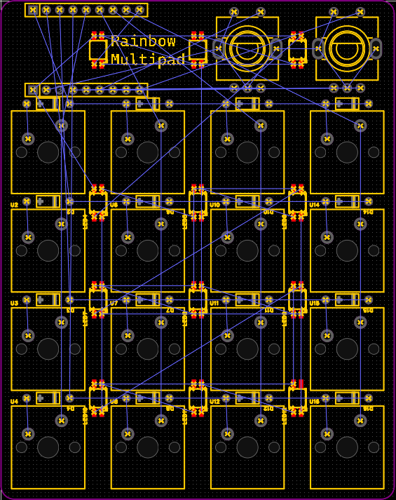

# HCSD Rainbow Multipad

The Rainbow Multipad is a 16 key, customized hack pad with 3 differnt modes and RGB lighting.

## Modes
### Numpad
- A pad with numbers ¯\(ツ)/¯ but it has an RGB underglow.

### Arrow key and Macropad
- Has arrow and function keys for common keyboard shortcuts.

### Led Editor
- Allows you to control the leds on the board, setting the color, brightness, and patterns.

## Components
All componets are from the Hackpad kit execept the microcontroller. I switched the microcontroller to a Waveshare ESP32-S3-Zero for the extra pins and bluetooth. 

### Materials
- 16x through-hole 1N4148 Diodes
- 16x MX-Style switches
- 2x EC11E Rotary encoders (with switch!)
- 12x SK6812 MINI-E LEDs
- Waveshare ESP32-S3-Zero
- Creativity and Imagination  

## PCB
I made the PCB in EasyEDA and added "Rainbow Multipad" because I usually never edit the silkscreen. 

### Schematic

### Layout

