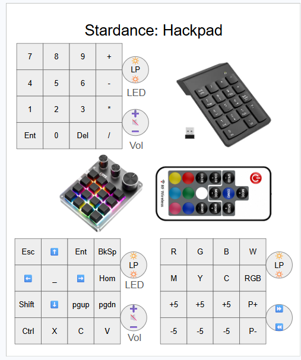
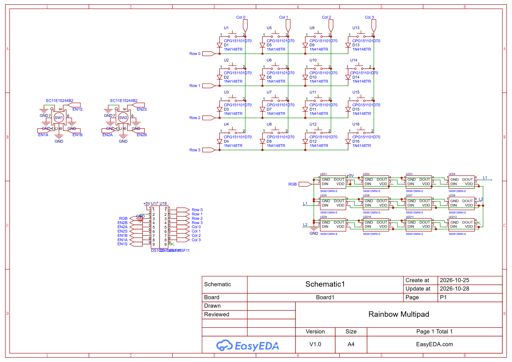

# HCSD Rainbow Multipad

The Rainbow Multipad is a 16 key, customized hack pad with 3 differnt modes and RGB lighting.

## Modes
### Numpad
- A pad with numbers ¯\(ツ)/¯ but it has an RGB underglow.

### Arrow key and Macropad
- Has arrow and function keys for common keyboard shortcuts.

### Led Editor
- Allows you to control the leds on the board, setting the color, brightness, and patterns.

## Components
All componets are from the Hackpad kit execept the microcontroller. There is a link to transparent switches for more LED light but regular ones work perfectly fine. I switched the microcontroller to a Waveshare ESP32-S3-Zero for the extra pins and bluetooth. 

### Materials
 Item | Price | Quantity | Link |
|:-|:-:|:-:|:-|
|Transparent MX-Style Switches |$0.2367|16|https://www.lcsc.com/product-detail/C49234239.html|
|1N4148 Diodes |$0.0183|16|https://www.lcsc.com/product-detail/C84410.html|
|EC11E Rotary Encoder|$2.398|2|https://www.lcsc.com/product-detail/C470754.html|
|SK6812 MINI-E LEDs|$0.081|12|https://www.lcsc.com/product-detail/C5149201.html|
|1x8 Female Pin Header|$0.0849|2|https://www.lcsc.com/product-detail/C7509520.html|
|Waveshare ESP32-S3 Zero|$5.49|1|https://www.waveshare.com/esp32-s3-zero.htm?sku=25081|
|PCB|$5.30|5|https://www.jlcpcb.com|
|Creativity and Imagination|$Free.99|ALL OF IT|Neurolink|

## PCB
I made the PCB in EasyEDA and added "Rainbow Multipad" because I usually never edit the silkscreen. 

### Schematic

### Layout

